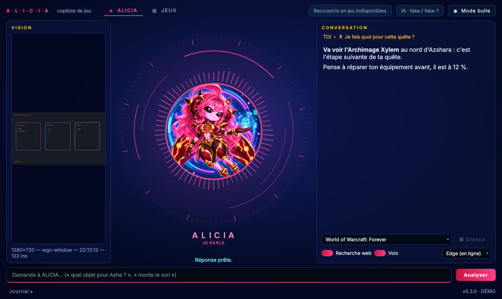

# COP'IA'LOTE — copilote IA pour jeux vidéo (Windows)

COP'IA'LOTE place une personnalité IA à côté du joueur : **ALICIA** ou **VIIRUS** (au choix, dans Réglages → Profil). Elle regarde la fenêtre de ton jeu, et quand tu lui poses une question, elle analyse la capture et te répond en quelques secondes. **Elle observe et conseille seulement** : aucun clic, aucune touche, aucune injection dans le jeu, aucune lecture de sa mémoire.



**Version 0.4** : profils ALICIA / VIIRUS, deux cerveaux (rapide et réfléchi), duo entre deux PC, overlay OBS. Historique de la 0.3 : capture d'une fenêtre (même en plein écran), question écrite (F9) ou orale (F10 maintenu), recherche web, réponse affichée mot par mot et lue à voix haute, logs détaillés. La capture automatique, la mémoire de session et les interventions spontanées arrivent dans les versions suivantes ([feuille de route](docs/architecture.md#feuille-de-route)).

## Installer

**Télécharge [ALICIA-Setup.exe](https://github.com/byRedemptiion/COP.IA.LOTE/releases/download/installer-latest/ALICIA-Setup.exe)** et double-clique dessus. C'est ce fichier qu'on partage.

1. Choisis ton IA : **Gemini** (recommandé, gratuit pour commencer), **ChatGPT** (API OpenAI, payante à l'usage : crédit prépayé, l'abonnement ChatGPT ne compte pas), **Ollama** (IA locale, avancé : ALICIA le démarre et télécharge son modèle toute seule) ou « plus tard ».
2. Pour Gemini, le bouton **« Ouvrir la page Gemini pour créer ma clé »** ouvre la page Google : *Create API key*, copie, colle. La clé reste sur ton PC (`%APPDATA%\Alicia\.env`).
3. L'installateur télécharge Python, les composants et les voix (environ 2 Go la première fois, quelques minutes), crée l'icône **ALICIA** sur le Bureau et dans le menu Démarrer.

- Aucun droit administrateur : ALICIA s'installe dans `%LOCALAPPDATA%\Programs\ALICIA`.
- Désinstallation : Paramètres Windows → Applications → ALICIA. Tes clés, tes jeux et tes réglages (`%APPDATA%\Alicia`) sont gardés.
- Windows peut afficher « Windows a protégé votre ordinateur » (installateur non signé) : **Informations complémentaires → Exécuter quand même**.
- Pas de clé pendant l'installation ? ALICIA te la demande au premier lancement (et le bouton **IA** du panneau permet d'en changer).

Depuis les sources (développement) : `git clone`, puis `Installer_Alicia.bat`.

## Lancer

Double-clique sur le raccourci **ALICIA** du Bureau (créé à l'installation ou à la première mise à jour), ou sur **`Lancer_Alicia.bat`**. **Aucun terminal ne reste ouvert** : seule ALICIA apparaît. Une fenêtre de progression ne s'affiche que si des composants doivent être installés.

- En jeu : **F10** maintenu pour lui parler, **F9** pour une analyse rapide.
- Pour une question écrite depuis le panneau : choisis la fenêtre du jeu dans l'onglet **JEUX**, tape ta question, puis **Entrée** ou **Analyser**.
- Le **Journal** (en bas du panneau) affiche chaque étape ; le fichier est dans `%LOCALAPPDATA%\Alicia\logs`.
- Diagnostic avec terminal : `Lancer_Alicia.bat --console`. Essai sans jeu : `Lancer_Alicia.bat --demo`.

### Mise à jour : bouton MAJ

Le bouton **⟳ MAJ** (en haut du panneau, ou **clic droit sur le rond → Mettre à jour ALICIA**) télécharge la dernière version depuis GitHub, remplace les fichiers d'ALICIA et la redémarre. Ta clé (`.env`), tes jeux et tes réglages ne sont jamais touchés. Au lancement, ALICIA vérifie discrètement s'il y a du nouveau : le bouton devient **MAJ dispo**.

- Branche suivie : `[update] branch` dans la config (aujourd'hui `alice-v0.3`).
- Si le dépôt devient **privé** : crée un jeton GitHub *fine-grained* en lecture seule (Repository access : ce dépôt ; Permissions : Contents → Read-only) et colle-le dans `.env` : `ALICIA_GITHUB_TOKEN=...`.

### Mode bulle : seule ALICIA à l'écran

Au lancement, **seul le rond d'ALICIA s'affiche**, en haut à droite, toujours au-dessus des autres fenêtres. Ses réponses apparaissent dans une bulle à côté **uniquement pendant un échange**, puis s'effacent toutes seules. La bulle laisse passer les clics vers le jeu, et ni le rond ni la bulle n'apparaissent dans les captures envoyées à l'IA.

- **Glisser** le rond pour le déplacer (la position est retenue) ; **double-clic** = panneau complet ; **clic droit** = menu (couper la voix, quitter…).
- Dans le panneau complet, le bouton **◉ Mode bulle** y revient.
- **Clic droit sur le rond → Mode édition** : taille du rond, largeur de la bulle, taille du texte, opacité, durée d'affichage et place de la bulle (gauche, droite, dessus, dessous), avec une bulle d'exemple et un aperçu en direct.
- Pour voir le rond par-dessus le jeu, règle le jeu en **plein écran fenêtré** (« sans bordure »). En plein écran exclusif, le jeu passe devant : F9, F10 et la voix marchent quand même.
- Pour démarrer sur le panneau complet : `mode = "full"` dans la section `[ui]` de `alicia.toml`.

### Réveil vocal : « Alicia… »

Plus besoin de F10 : **commence ta phrase par « Alicia »**. « Alicia, lance Discord », « Alicia, quel objet je prends ? », « Alicia, éteins le PC ». Tu peux aussi dire « Alicia » seul, attendre que le rond passe au cyan, puis faire ta demande.

- Tout reste **sur ton PC** : un petit modèle Whisper local repère son nom au début des phrases ; tant qu'il n'est pas dit, rien n'est envoyé ni gardé.
- **Elle écoute même quand elle parle** : « Alicia, … » la coupe et devient ta nouvelle demande. **« Alicia, stop »** (ou « tais-toi », « chut ») la fait taire et annule l'analyse en cours (pendant qu'elle réfléchit, c'est la seule phrase écoutée).
- **Pas besoin de redire « Alicia » pour répondre** : après « Tu confirmes ? » ou « Dis annule… », elle écoute ta réponse pendant 8 s (le rond passe au cyan).
- **Onglet RACCOURCIS** : change la touche pour lui parler (F10) ou celle de l'analyse (F9) — clique, puis appuie sur la nouvelle touche, ou sur un **bouton latéral de souris** (4/5, le jeu le reçoit toujours). La liste des commandes vocales y est aussi.
- Case **Réveil « Alicia »** dans le panneau, ou **clic droit sur le rond**, pour la couper (par exemple en vocal avec des amis qui disent son nom).
- Premier lancement : le petit modèle (~140 Mo) se télécharge tout seul en arrière-plan.

### Parler à Alicia : F10 (maintenir)

**Maintiens F10 en jeu, pose ta question à voix haute, relâche.** Alicia capture l'écran, envoie ta voix et l'image à Gemini, affiche ta question transcrite puis **répond à voix haute**. Pour la couper, réappuie sur F10 ou clique sur « Couper la voix ».

- **Ta voix est comprise sur ton PC** par faster-whisper (modèle `large-v3-turbo`, sur le processeur : gratuit, privé, n'utilise pas la carte graphique du jeu). Plus rapide mais moins précis : `[voice] whisper_model = "small"`. Pour revenir à l'envoi direct de l'audio à Gemini : `[voice] stt = "gemini"`.
- **Deux voix pour Alicia, au choix dans le menu à côté de « Réponse vocale »** : Edge (voix Microsoft `fr-FR-DeniseNeural`, gratuite, en ligne) ou Kokoro (voix française `ff_siwis`, locale et hors ligne, calculée sur le processeur). Autres voix Edge : `uv run alicia-diag voices`.
- Les modèles locaux (Whisper ≈ 800 Mo, Kokoro ≈ 340 Mo) sont téléchargés une seule fois à l'installation, dans `%LOCALAPPDATA%\Alicia\models`.
- Micro ou haut-parleur précis : `uv run alicia-diag devices`, puis `[voice] input_device` / `output_device` (une partie du nom suffit).
- Tester sans jeu : `uv run alicia-diag record` (micro), `uv run alicia-diag transcribe micro.wav` (compréhension) et `uv run alicia-diag say --engine kokoro` (voix).
- Le micro n'est ouvert que pendant que tu maintiens F10 : rien n'est écouté en dehors, et aucun enregistrement n'est gardé sur le disque.

### Actions sur le PC (comme un Jarvis)

Avec **F10** ou à l'écrit, Alicia exécute certaines demandes **sur Windows, jamais dans le jeu** :

| Exemple | Action | Sécurité |
| --- | --- | --- |
| « Monte le son », « baisse le volume de 20 », « volume à 30 », « coupe le son » | Volume | immédiat |
| « Lance Discord », « ouvre Spotify » | Applis de la liste `[actions.apps]` | immédiat |
| « Rappelle-moi dans 20 minutes de manger », « minuteur de 5 minutes » | Rappel dit à voix haute | immédiat |
| « Verrouille le PC », « mets le PC en veille », « ferme Discord » | Session, veille, fermeture d'appli | **confirmation** (« oui » / « non ») |
| « Éteins le PC », « redémarre le PC » | Extinction / redémarrage | **confirmation + 20 s**, « annule » l'arrête |

- Les demandes sont reconnues **sur ton PC, sans IA** (instantané, gratuit, hors ligne). Seules les actions de cette liste existent : Alicia ne peut jamais lancer une commande libre.
- Un « non » l'emporte toujours, et une confirmation expire au bout de 20 s.
- Ajouter une appli dans `alicia.toml` :

```toml
[actions.apps]
obs = { launch = "C:/Program Files/obs-studio/bin/64bit/obs64.exe", process = "obs64.exe" }
```

### Ce que regarde ALICIA : application, curseur ou écran

Menu **Vision** (panneau, clic droit sur le rond, ou Réglages) :
- **L'application** : le jeu au premier plan (par défaut).
- **Autour du curseur** : une zone autour de ta souris ; pointe un objet, un sort ou un texte et demande « c'est quoi ça ? ». Un cercle rose montre à l'IA ce que tu désignes. Taille de la zone dans Réglages.
- **L'écran entier** : tout l'écran du jeu (pratique avec un guide ou une carte à côté).
- **Vision en direct** (activée par défaut, Réglages → Vision) : ALICIA garde en mémoire une capture récente (toutes les secondes). Quand tu commences à parler (F10 ou « Alicia… »), l'image de cet instant est déjà prête : pas besoin de F9, et l'IA voit l'écran du moment où tu as parlé. Rien n'est envoyé tant que tu ne poses pas de question.

### Mémoire de partie : « il y a une heure… »

Pendant la vision en direct, ALICIA garde une petite image datée toutes les 30 s. Demande « il y a une heure, c'était quoi mon objet ? », « tout à l'heure, tu as vu le boss ? » ou « à 21h30, j'étais où ? » : les images de ce moment partent avec ta question.

- Nettoyage automatique au lancement et toutes les heures : images de plus de 20 h effacées, 10 000 images et 5 Go au plus (réglables).
- **Réglages → Mémoire de partie** : fréquence, durée (jusqu'à 30 jours), place maximale (jusqu'à 500 Go), **disque ou dossier dédié**, effacement à la fermeture, bouton « Effacer maintenant ».
- Les images restent sur ton PC et ne partent à l'IA que si ta question parle du passé.

### Tes jeux et tes sites de référence

ALICIA a un **profil par jeu** : elle sait à quel jeu tu joues (sans le deviner sur l'image), quoi regarder à l'écran, et **sur quels sites chercher en premier** quand la recherche web est active. Profils fournis : **Overwatch** et **World of Warcraft: Forever** (Icy Veins, Method, Mobalytics, Warcraft Tavern, Warcraft Wiki).

- Le jeu est reconnu tout seul à sa fenêtre. Tu peux aussi le choisir : menu du panneau, ou **clic droit sur le rond → Jeu**.
- **Plusieurs versions d'un même jeu** (WoW actuel, Classic, Forever…) : elles ont le même titre de fenêtre, ALICIA les distingue par leur **dossier d'installation** (`_retail_`, `_classic_`, `_forever_`). Sur la fiche d'un jeu, « Remplir avec la fenêtre du jeu » reprend le programme et le dossier de la fenêtre observée, et **Dupliquer** crée une nouvelle version à partir d'un jeu existant.
- **Onglet JEUX** (en haut du panneau) : tous tes jeux en cartes. Clique sur un jeu pour ouvrir sa fiche : **ajoute un site** (colle simplement l'adresse), retire-en, change l'ordre (du plus fiable au moins fiable), règle comment le reconnaître et ce qu'ALICIA doit savoir. « Enregistrer » et c'est pris en compte tout de suite. « ＋ Ajouter un jeu » crée un nouveau jeu, prérempli avec la fenêtre observée.
- La **fenêtre du jeu** se choisit aussi dans cet onglet (inutile en jeu : F9 et F10 prennent la fenêtre au premier plan).
- Tout est enregistré dans `%APPDATA%\Alicia\games.toml`, modifiable à la main (`Mes_Jeux_Alicia.bat` l'ouvre). « Rétablir l'original » annule tes changements sur un jeu fourni.
- Le journal indique le jeu reconnu et le nom du programme (`Jeu : … (fenêtre xxx.exe, détecté)`), utile pour ajouter un jeu.

### Recherche web

La case **Recherche web** laisse Gemini faire une recherche Google avant de répondre : méta actuelle, builds, notes de patch. Les sources s'affichent sous la réponse. Cela ajoute une à deux secondes ; l'offre gratuite a aussi un quota de recherches par jour.

### Jouer en plein écran : le raccourci F9

En plein écran, un jeu se réduit souvent dès que tu cliques sur une autre fenêtre : Alicia ne peut alors plus le capturer. Reste dans le jeu et **appuie sur F9** : Alicia capture la fenêtre active et lance l'analyse, avec la question tapée dans Alicia ou, à défaut, une question générale. Quand la réponse est prête, Alicia clignote dans la barre des tâches. Le raccourci se change dans `alicia.toml` (`[hotkeys] analyze = "ctrl+F9"`) ; tant qu'Alicia est ouverte, le jeu ne reçoit plus cette touche.

### Overwatch et jeux en plein écran

- Alicia utilise la capture Windows Graphics Capture : elle fonctionne en fenêtré, en plein écran fenêtré et, sous Windows 11, en général aussi en plein écran.
- Si la fenêtre sort noire en plein écran, Alicia capture **l'écran entier où se trouve le jeu** et l'indique sous l'aperçu (« Repli après : … »).
- Alicia n'utilise que des API publiques de Windows, comme OBS ou Discord. Blizzard peut cependant considérer des conseils en direct en partie classée comme une aide extérieure : teste plutôt en **Stadium** (choix d'objets), en entraînement ou en partie personnalisée.

## Fournisseur d'IA

| Fournisseur | Réglage | Coût | Avantage | Limite |
| --- | --- | --- | --- | --- |
| **Gemini** (défaut) | `GEMINI_API_KEY` dans `.env` | offre gratuite (quota par minute et par jour) | rapide, ne prend pas de GPU au jeu | nécessite Internet |
| Ollama (local) | `ALICE_AI_PROVIDER=ollama` + [Ollama](https://ollama.com) + `ollama pull qwen2.5vl:7b` | gratuit | hors ligne | partage le GPU avec le jeu, plus lent |
| Factice | `ALICE_AI_PROVIDER=fake` | — | tests sans réseau | ne regarde pas l'image |

Pour aller plus vite : créer un fichier `alicia.toml` à la racine avec, par exemple :

```toml
[ai.gemini]
model = "gemini-flash-lite-latest"   # plus rapide, un peu moins précis
```

`alicia-diag models` liste les modèles accessibles avec ta clé. Tous les réglages et leur valeur par défaut sont dans [`src/alicia/default.toml`](src/alicia/default.toml).

## Diagnostic

Les logs sont dans `%LOCALAPPDATA%\Alicia\logs\alicia.log` (bouton **Ouvrir le dossier des logs**). Coche **Logs détaillés** ou lance `Lancer_Alicia.bat --debug` pour plus de détails. Les clés ne sont jamais écrites dans les logs ; les questions et réponses ne le sont qu'en mode détaillé.

Outils en ligne de commande (dans le dossier du projet) :

```powershell
uv run alicia-diag list-windows                      # fenêtres vues par Alicia
uv run alicia-diag capture overwatch --out ow.png    # capture seule, sans IA
uv run alicia-diag capture overwatch --backend printwindow
uv run alicia-diag ask ow.png "Quel objet est le meilleur ?"
uv run alicia-diag models                            # modèles Gemini disponibles
```

| Problème | Que faire |
| --- | --- |
| « Clé Gemini manquante / refusée » | Vérifier la ligne `GEMINI_API_KEY=` dans `.env`, puis relancer. |
| « Quota Gemini atteint » | Attendre une minute (limite de l'offre gratuite). |
| Capture noire ou refusée | Essayer le mode plein écran fenêtré du jeu ; envoyer `alicia-diag capture … --debug` et le log. |
| « Modèle introuvable » | `alicia-diag models`, puis indiquer un modèle de la liste dans `alicia.toml`. |

## Développer

```powershell
uv sync --python 3.12 --extra dev
uv run pytest -q
uv run ruff check src tests
uv run alicia --smoke-test     # parcours complet hors écran, IA factice
```

Architecture et choix techniques : [docs/architecture.md](docs/architecture.md). Cahier des charges : [docs/cahier-des-charges.md](docs/cahier-des-charges.md).
