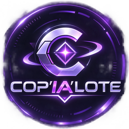
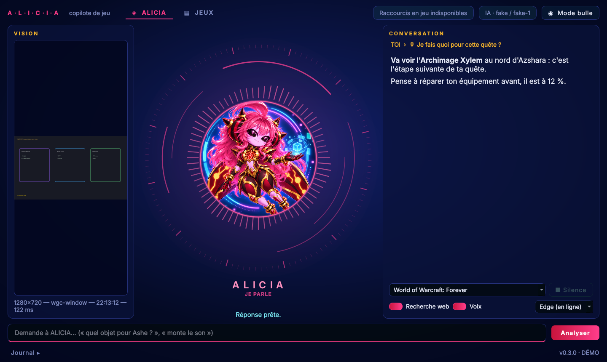

<p align="center"></p>

# COP'IA'LOTE — copilote IA pour jeux vidéo (Windows)

**COP'IA'LOTE** est un copilote de jeu qui vit à côté de toi pendant tes parties. Il regarde ton écran, t'écoute quand tu lui parles, te répond à voix haute, et peut même intervenir de lui-même quand quelque chose d'important se passe. Deux personnalités au choix (Réglages → Profil) :

- **VIIRUS** : petit robot espiègle, voix de robot ;
- **ALICIA** : sa coéquipière, voix féminine.

Il **observe et conseille seulement** : aucun clic, aucune touche, aucune injection dans le jeu, aucune lecture de sa mémoire. Uniquement des images de l'écran, via les API publiques de Windows (comme OBS ou Discord).



## Sommaire

- [Installer](#installer) · [Lancer](#lancer) · [Mise à jour](#mise-à-jour--bouton-maj)
- [Lui parler](#lui-parler) · [Mode Copilote](#mode-copilote) · [Mode Stream](#mode-stream--répondre-au-chat-twitch)
- [Voix](#voix) · [Duo](#duo--viirus-et-alicia-ensemble) · [Guides et images](#guides-et-images)
- [Jeux et sites de référence](#jeux-et-sites-de-référence) · [Actions sur le PC](#actions-sur-le-pc) · [Vision et mémoire](#vision-et-mémoire-de-partie)
- [IA et clés](#ia-et-clés) · [Confidentialité](#confidentialité-et-sécurité) · [Diagnostic](#diagnostic) · [Développer](#développer)

## Installer

**Télécharge [COPIALOTE-Setup.exe](https://github.com/byRedemptiion/COP.IA.LOTE/releases/download/installer-latest/COPIALOTE-Setup.exe)** et double-clique dessus. C'est ce fichier qu'on partage.

1. Choisis ton IA : **Gemini** (recommandé), **ChatGPT** (API OpenAI, payante à l'usage : crédit prépayé, l'abonnement ChatGPT ne compte pas), **Ollama** (IA locale, avancé) ou « plus tard ».
2. Pour Gemini, le bouton **« Ouvrir la page Gemini pour créer ma clé »** ouvre la page Google : *Create API key*, copie, colle. La clé reste sur ton PC.
3. L'installateur télécharge Python, les composants et les voix locales (environ 2 Go la première fois, quelques minutes) et crée l'icône sur le Bureau et dans le menu Démarrer. L'icône prend ensuite le nom et l'image de ton profil (VIIRUS ou ALICIA).

- Aucun droit administrateur nécessaire.
- Désinstallation : Paramètres Windows → Applications → COP'IA'LOTE. Tes clés, tes jeux et tes réglages sont gardés.
- Windows peut afficher « Windows a protégé votre ordinateur » (installateur non signé) : **Informations complémentaires → Exécuter quand même**.
- Pas de clé pendant l'installation ? Elle t'est demandée au premier lancement.

## Lancer

Double-clique sur l'icône du Bureau. Aucun terminal ne reste ouvert.

- **Mode bulle** : seul le rond du robot reste à l'écran, en haut à droite, par-dessus le jeu. Ses réponses s'affichent dans une bulle (15 s au plus) puis s'effacent. Glisser = déplacer, double-clic = panneau complet, clic droit = menu (mode édition, voix, Copilote, jeu, réglages…).
- **Panneau complet** : vision du jeu et état du Duo à gauche, le robot au centre, la conversation à droite. En haut : **💡 Copilote**, **📺 Stream**, **◉ Mode bulle**, les réglages et la mise à jour.
- **États du rond** : EN VEILLE, **OBSERVE** (le Copilote regarde ta partie), **À L'ÉCOUTE** (il prend ta demande), RÉFLÉCHIT, PARLE.
- Pour voir le rond par-dessus le jeu, règle le jeu en **plein écran fenêtré** (« sans bordure »). En plein écran exclusif, le raccourci et la voix marchent quand même.

### Mise à jour : bouton MAJ

Le bouton **⟳ MAJ** (ou clic droit sur le rond → Mettre à jour) télécharge la dernière version depuis GitHub, l'installe et redémarre. Tes clés, tes jeux et tes réglages ne sont jamais touchés. Au lancement, le bouton devient **MAJ dispo** s'il y a du nouveau.

## Lui parler

- **Dis son nom en début de phrase** : « VIIRUS, quel objet je prends ? », « Alicia, lance Discord ». Ou son nom seul, puis ta demande quand le rond passe à **À L'ÉCOUTE**.
- **Ou maintiens le raccourci** (F10 par défaut, ou un bouton latéral de souris : onglet Raccourcis) et parle.
- Le micro attend son nom **sur ton PC** (petit modèle Whisper local) : rien n'est envoyé tant que son nom n'est pas dit.
- Ta demande est transcrite par ton IA en ligne (Gemini ou OpenAI, environ 1 s), ou sur ton PC si tu préfères (Réglages → Perception).
- **« VIIRUS, stop »** le fait taire. Après une question de sa part (« Tu confirmes ? »), pas besoin de redire son nom.
- **« Je m'appelle Yannick »** : il retient ton prénom pour toujours (aussi dans Réglages → Profil).
- Il voit l'écran **du moment où tu as commencé à parler**, et **commence à répondre dès sa première phrase**, sans attendre la fin.

## Mode Copilote

**💡 Copilote** (ou « active le copilote ») : il jette un coup d'œil à ta partie à intervalle régulier (8 s à 2 min) et **ne parle que si ça vaut le coup** : danger, erreur, opportunité, moment marquant.

- Réglages → Copilote : **spontanéité** (discret, normal, bavard), **types d'interventions** (conseils, alertes, réactions, humour, trash-talk bienveillant, remarques pour le duo), délai de silence entre deux interventions. Une vraie urgence passe toujours.
- Il se tait quand tu parles, quand il parle déjà, et **ne dépense aucun appel à l'IA hors jeu** (bureau, Discord, navigateur, OBS…).
- Une clé refusée ou un quota atteint le mettent en pause, avec un message.

## Mode Stream : répondre au chat Twitch

**📺 Stream** (ou « active le mode stream ») : il lit le chat de ta chaîne Twitch (Réglages → Stream) et **répond à voix haute** aux spectateurs.

- Lecture seule, sans compte : il n'écrit jamais dans le chat.
- Il répond quand on le nomme (« @VIIRUS », « !viirus »), aux questions, ou à tout de temps en temps ; une réponse toutes les 20 s au plus (réglable) ; pseudos ignorés au choix.
- Les messages du chat sont traités comme des messages d'inconnus : **jamais d'action sur ton PC**, jamais lus mot pour mot. Bots, liens, insultes et tentatives de lui faire dire quelque chose sont ignorés.
- **Overlay OBS** : une page à ajouter comme source « Navigateur » (adresse dans Réglages → Stream). Le robot y flotte, s'anime, et ses réponses s'affichent en sous-titres.
- **🔊 Sa voix dans OBS** : la page joue aussi sa voix (cocher « Contrôler l'audio via OBS » dans la source) : il a sa propre piste dans le mélangeur d'OBS (volume, muet).

## Voix

Réglages → Profil → **Catalogue des voix** : ▶ Écouter, puis Choisir.

| Moteur | Coût | Note |
| --- | --- | --- |
| **Edge** (Microsoft) | gratuit | 13 voix françaises, en ligne, sans quota |
| **Gemini** (Google) | ta clé Gemini | 30 voix expressives |
| **ChatGPT** (OpenAI) | ta clé OpenAI | 13 voix très naturelles |
| **✨ Voix sur mesure** (Gemini 3.8) | ta clé Gemini | tu décris la voix, Google la crée ; ✏️ renommer, ✕ supprimer |
| **VIIRUS / ALICIA** (sur ton PC) | gratuit | voix robot locales, hors ligne |

- **Effets** : Masculin, Féminin, Jeune, Robot, Petite robote, Petit robot (VIIRUS), Gros robot ; « Réglages fins » pour la hauteur, le métal et la clarté. Les voix sur mesure n'ont jamais d'effet sonore.
- **Jeu de voix** : une consigne libre pour Gemini et ChatGPT (« voix posée et chaleureuse… »).
- **Clé voix** (Réglages → IA → Avancé) : une clé à part pour la voix, par exemple réfléchir avec ChatGPT et parler avec une voix Gemini.
- Si une voix en ligne ne répond pas (quota atteint, coupure), **sa voix locale prend le relais** et un message te le dit. Attention : les voix Gemini sont limitées par Google (au niveau 1 : 10 demandes par minute et 100 par jour).

## Duo : VIIRUS et ALICIA ensemble

Deux joueurs, deux PC, deux robots qui se parlent (Réglages → Social → Duo, même code des deux côtés).

- Le panneau **DUO** montre si l'autre robot est là.
- « VIIRUS, demande à Alicia ce qu'elle pense de mon build » : la question est transmise, la réponse revient à voix haute. Les robots peuvent aussi discuter entre eux.
- Messages chiffrés de bout en bout, jamais d'action sur le PC à partir d'un message reçu.
- **Personnes** (Réglages → Social) : les prénoms et la prononciation des gens avec qui tu joues.

## Guides et images

Avec la recherche web, il trouve le bon guide et peut **ouvrir la page** ou **afficher l'image utile** (carte, emplacement) dans un petit panneau flottant. À la voix : « ouvre le guide », « montre-moi la carte », « ferme l'image ». Il n'ouvre que des pages vraiment trouvées par la recherche, jamais une adresse inventée.

## Jeux et sites de référence

Onglet **Jeux** : un profil par jeu, reconnu tout seul à sa fenêtre (ou à son .exe), avec **tes sites de référence** à consulter en premier. Profils fournis (Overwatch, World of Warcraft…) modifiables, masquables ; « ＋ Ajouter un jeu » pour les autres. Tout est dans `%APPDATA%\Alicia\games.toml`.

## Actions sur le PC

Quelques demandes sont exécutées **sur Windows, jamais dans le jeu**, reconnues sur ton PC sans IA :

| Exemple | Action | Sécurité |
| --- | --- | --- |
| « Monte le son », « volume à 30 », « coupe le son » | Volume | immédiat |
| « Lance Discord », « ouvre YouTube » | Applis de la liste | immédiat |
| « Rappelle-moi dans 20 minutes de manger » | Rappel à voix haute | immédiat |
| « Verrouille le PC », « ferme Discord » | Session, fermeture d'appli | **confirmation** |
| « Éteins le PC », « redémarre le PC » | Extinction / redémarrage | **confirmation + 20 s**, « annule » l'arrête |

Seules les actions de cette liste existent : il ne peut jamais lancer une commande libre.

## Vision et mémoire de partie

- **Vision** : l'application au premier plan (par défaut), la zone autour du curseur (« c'est quoi ça ? ») ou l'écran entier.
- **Vision en direct** : une capture récente est gardée en mémoire ; rien n'est envoyé tant que tu ne demandes rien (ou que le Copilote n'est pas actif).
- **Mémoire de partie** : une petite image datée toutes les 30 s, sur ton PC, pour « il y a une heure, c'était quoi mon objet ? ». Durée, place et dossier réglables, nettoyage automatique.

## IA et clés

| IA | Coût | Avantage | Limite |
| --- | --- | --- | --- |
| **Gemini** (recommandé) | offre gratuite puis à l'usage | rapide, ne prend pas le GPU du jeu | Internet |
| **ChatGPT** (API OpenAI) | à l'usage (crédit prépayé) | très bonnes réponses | Internet |
| **Ollama** (local) | gratuit | hors ligne | partage le GPU avec le jeu, plus lent |

- **Deux cerveaux** : un rapide pour les réponses courantes, un réfléchi pour les questions complexes (Réglages → IA).
- **Clés** : Réglages → IA → Avancé → **Gérer mes clés** (plusieurs clés par fournisseur, test de la clé). Elles restent dans `%APPDATA%\Alicia\.env`, jamais affichées ni journalisées.
- Tous les réglages et leur valeur par défaut : [`src/alicia/default.toml`](src/alicia/default.toml).

## Confidentialité et sécurité

- Aucune entrée envoyée au jeu, aucune lecture de sa mémoire : uniquement des images de l'écran.
- Les images et ta voix ne partent à l'IA que lorsque tu poses une question, ou pendant le mode Copilote si tu l'actives.
- Les clés ne quittent ton PC que vers leur fournisseur, et n'apparaissent jamais dans les journaux.
- Messages du duo et du chat Twitch : de simples données, jamais des ordres pour ton PC.

## Diagnostic

Journal : `%LOCALAPPDATA%\Alicia\logs\alicia.log` (bouton **Journal** en bas du panneau). Lancement avec terminal : menu Démarrer → « (diagnostic, avec terminal) ».

| Problème | Que faire |
| --- | --- |
| « Clé refusée » | Réglages → IA → Avancé → Gérer mes clés, puis « Tester ». |
| « Quota atteint » | Attendre (une minute, ou le lendemain pour un quota par jour). |
| Il ne m'entend pas | Réglages → Perception → micro et « Tester le micro » ; vérifier le réveil vocal. |
| Capture noire | Mettre le jeu en plein écran fenêtré ; envoyer le journal. |
| La mise à jour échoue | Fermer COP'IA'LOTE, puis relancer `Lancer_Alicia.bat` dans `%LOCALAPPDATA%\Programs\ALICIA`. |

Outils en ligne de commande (dossier du projet) : `uv run alicia-diag list-windows`, `capture`, `ask`, `models`, `devices`, `voices`.

## Développer

```powershell
uv sync --python 3.12 --frozen --extra dev
uv run --frozen ruff check src tests
uv run --frozen pytest -q
uv run --frozen alicia --smoke-test     # parcours complet hors écran, IA factice
```

Branche stable : `alice-v0.3` (suivie par le bouton MAJ). Le code garde le nom technique `alicia` (paquet Python, dossiers `%APPDATA%\Alicia` et `%LOCALAPPDATA%\Alicia`) pour que les installations existantes et leurs réglages continuent de fonctionner.

Architecture : [docs/architecture.md](docs/architecture.md) · Cahier des charges : [docs/cahier-des-charges.md](docs/cahier-des-charges.md) · Règles du projet : [AGENTS.md](AGENTS.md).
